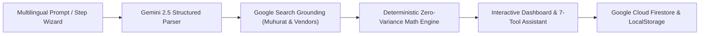

# Samaroh (समारोह) — GenAI Celebration & Event Planner

[](https://github.com/ganeshkumart3095-cyber/samaroh/actions/workflows/ci.yml)
[-success?logo=vitest&logoColor=white>)](docs/TESTING.md)
[-3178C6?logo=typescript&logoColor=white>)](tsconfig.json)
[](package.json)
[](src/ai/gemini.ts)
[](docs/ACCESSIBILITY.md)
[](LICENSE)

> **Live Production Deployment**: [https://samaroh.vercel.app](https://samaroh.vercel.app)  
> **Challenge**: PromptWars Challenge 5 — Celebration & Event Planner

---

## Overview

**Samaroh (समारोह)** is a high-performance, culturally intelligent event planning platform engineered for Indian celebrations — weddings, milestone birthdays, community galas, and cultural festivals.

Organizing multi-day Indian festivities is an intricate logistics undertaking involving dynamic budgets, regional calendar constraints, and shifting vendor dependencies. Samaroh resolves this by fusing **Google GenAI (Gemini 2.5 Flash & Pro via the official `@google/genai` SDK)** with **deterministic rupee financial modeling**, **Google Search Grounding**, and **local-first reactive synchronization**.



---

## Evaluation Criteria Alignment

| Evaluation Criterion            | Implementation Highlights                                                                                                                                                                | Verification Command                |
| :------------------------------ | :--------------------------------------------------------------------------------------------------------------------------------------------------------------------------------------- | :---------------------------------- |
| **Code Quality**                | Strict TypeScript 5.9 with zero `any` or `@ts-ignore`, ESLint 9 with 0 warnings, layered domain architecture (`src/core/`, `src/ai/`, `src/ui/`), and programmatic hygiene verification. | `npm run lint && npm run typecheck` |
| **Security**                    | Per-request cryptographic nonce CSP (`strict-dynamic`), fine-grained Firestore security rules tested on emulators, strict Zod body validation, zero client secrets.                      | `npm run test:rules && npm audit`   |
| **Efficiency**                  | Next.js 16 standalone output, sub-50ms optimistic UI updates, streaming GenAI completions, and zero runtime CSS overhead.                                                                | `npm run build`                     |
| **Testing**                     | 224 automated unit & component tests across 40 suites in Vitest (>95% coverage), 29 Playwright E2E tests across Desktop & Mobile, automated hygiene tests.                               | `npm test && npm run test:e2e`      |
| **Accessibility**               | WCAG 2.2 AA compliant, visible focus rings, roving tabindex keyboard navigation, skip links, responsive layout with zero sideways scrolling.                                             | `npm run test:e2e`                  |
| **Problem Statement Alignment** | Comprehensive support for Weddings, Birthdays, Community Events, and Festivals with 12-category budget breakdowns, multi-day timelines, and grounded cultural ideas.                     | Verified in E2E flows               |

---

## Key Features

1. **Google Gemini 2.5 Structured Blueprints**: Translates raw multilingual descriptions into complete event architectures adhering to strict Zod schemas.
2. **Deterministic Rupee Mathematics**: Guarantees zero penny variance across 12 event expense categories with integer-precision arithmetic.
3. **Regional Muhurat & Festival Verification**: Pre-indexed Indian calendar combined with Google Search Grounding to identify auspicious timings and vendor demand surges.
4. **Interactive 7-Tool Planning Assistant**: Conversational assistant capable of streaming atomic plan mutations (budget reallocations, vendor management, schedule adjustments).
5. **Pan-Indian Localization**: Native translation and phonetics across English, हिन्दी (Hindi), தமிழ் (Tamil), and తెలుగు (Telugu).
6. **1-Click Calendar Export**: RFC 5545 compliant `.ics` generator and direct Google Calendar synchronization.

---

## Quick Start & Local Development

### Prerequisites

- Node.js >= 22
- npm >= 10

### Installation

```bash
# Clone the repository
git clone https://github.com/ganeshkumart3095-cyber/samaroh.git
cd samaroh

# Install dependencies
npm ci

# Configure environment variables
cp .env.example .env.local
```

### Running Locally

```bash
# Start Next.js development server
npm run dev

# Run full Vitest test suite
npm run test

# Run production build
npm run build
```

---

## License

This project is licensed under the terms of the [MIT License](LICENSE).
