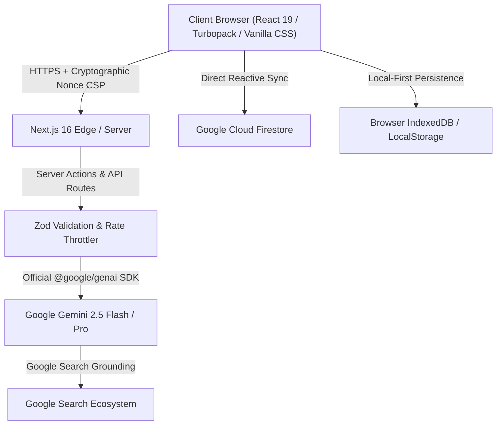

# Samaroh Architecture & Engineering Design

**Samaroh (समारोह)** is a high-performance, culturally attuned Indian celebration and event planning platform engineered with Next.js 16, TypeScript 5.9 strict mode, Google Cloud Firebase Firestore, and the official Google GenAI SDK (`@google/genai`) powered by Gemini 2.5 Flash and Pro.

---

## 1. System Topology

---

## 2. Layered Architecture

### A. Core Mathematical & Deterministic Domain (`src/core/`)

- **Zero-Variance Budget Allocator (`src/core/allocate.ts`)**: Pure arithmetic dividing total event budgets across 12 distinct Indian celebration categories (Venue, Catering, Photography, Decor, Entertainment, Attire, Makeup, Invites, Gifts, Transport, Logistics, Contingency) with integer-precision rupee mathematics.
- **Regional Muhurat & Festival Calendar (`src/core/calendar.ts`)**: Pre-indexed multi-year calendar of major Indian festive periods (Diwali, Navratri, Dussehra, Makar Sankranti, Pongal, Eid, etc.) flagging high-demand vendor pricing surges and auspicious dates.
- **ICS / Google Calendar Exporter (`src/core/ics.ts`)**: Deterministic RFC 5545 iCalendar standard generation for seamless 1-click import into Google Calendar, Apple Calendar, and Outlook.

### B. Artificial Intelligence Engine (`src/ai/`)

- **Gemini 2.5 Engine (`src/ai/gemini.ts`)**: Interfaces with `@google/genai` utilizing structured output schemas (`zodResponseFormat`) to prevent hallucination.
- **7-Tool Planning Assistant (`src/ai/assistant.ts`)**: Conversational agent executing real-time plan mutations:
  1. `reallocate_budget`
  2. `reschedule_function`
  3. `add_vendor_quote`
  4. `update_guest_count`
  5. `suggest_cultural_rituals`
  6. `verify_calendar_conflicts`
  7. `export_summary`
- **Fallback Engine (`src/ai/fallback.ts`)**: Guarantees zero downtime by switching gracefully between live Gemini 2.5 Pro, Gemini 2.5 Flash, and deterministic heuristic generators if network connectivity is severed.

### C. Security & Defense in Depth (`src/server/` & `firestore.rules`)

- **Cryptographic Per-Request Nonce CSP**: Hardened Content Security Policy completely disabling `unsafe-eval`, locking frame ancestry, and restricting script execution to cryptographically signed nonces.
- **Fine-Grained Firestore Security Rules**: Collection-level authorization enforcing owner, editor, and viewer role boundaries, disallowing unauthorized sharing or data tampering.

### D. User Interface & Design System (`src/ui/`)

- **Festive Diya Motif**: Sacred Brass Diya glow aesthetics and marigold garland strands styled with zero-runtime CSS modules.
- **Pan-Indian Localization (`src/i18n/`)**: Native translation strings across English, हिन्दी (Hindi), தமிழ் (Tamil), and తెలుగు (Telugu).
